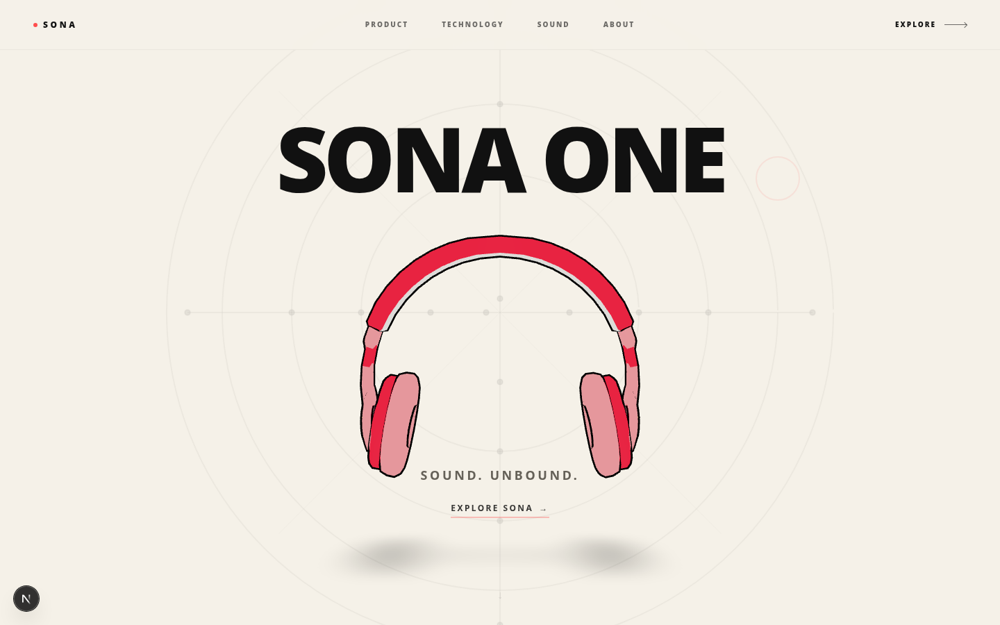
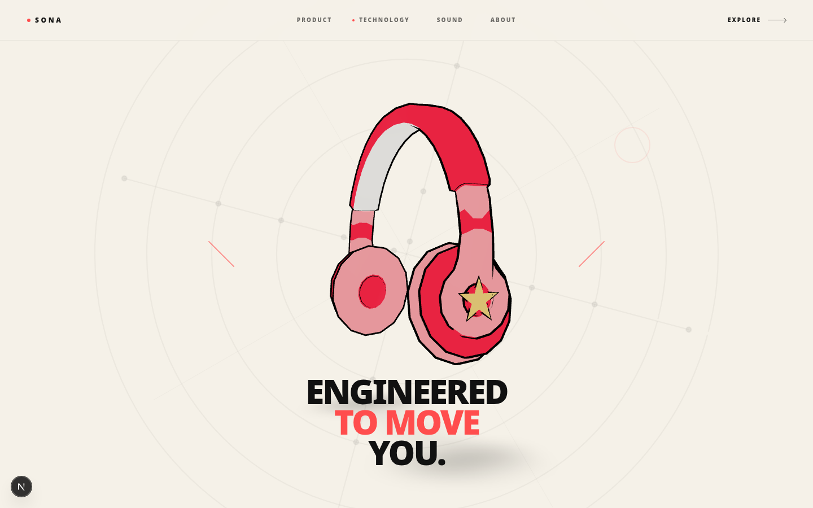
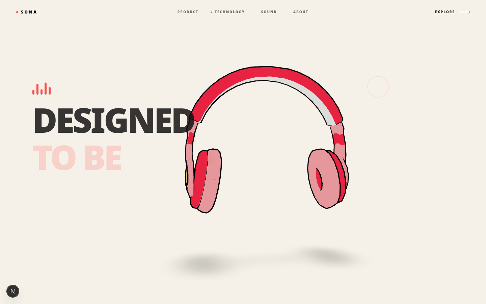
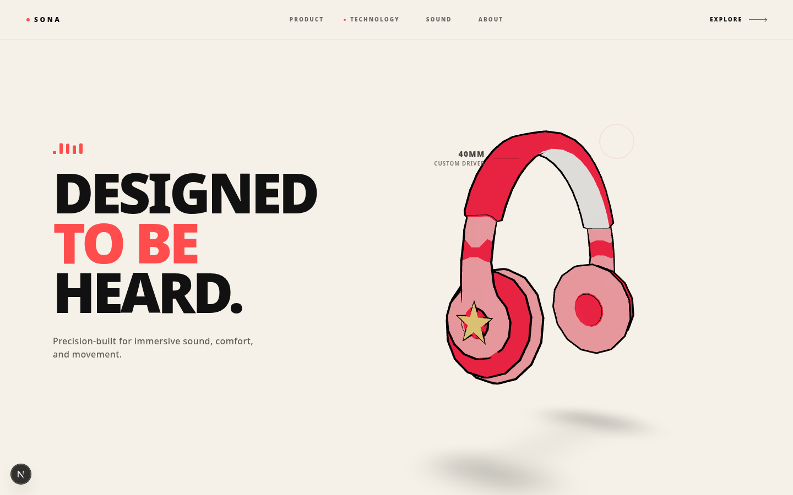

# SONA ONE - Premium Headphone Experience

A highly interactive, 3D-driven web experience built to showcase the fictional SONA ONE premium wireless headphones. This project focuses on cinematic product storytelling, fluid scroll animations, and minimalist architectural design.



## Core Features

- **Scroll-Driven 3D Exploration:** Built with React Three Fiber and GSAP, the 3D headphone model acts as the continuous central element. As the user scrolls, the camera, lighting, and model rotation smoothly transition between narrative phases.
- **Cinematic Storytelling:** Instead of disjointed sections, the experience flows continuously from a technical blueprint intro, through product reveals, into an immersive sound field, and concludes with an interactive configurator.
- **Premium Minimalist Design:** Employs a restrained color palette, high-fidelity typography, technical polar grids, and extremely subtle hover interactions to evoke the feeling of high-end hardware engineering.



- **Intelligent Navigation:** A custom smooth-scroll navigation system that bridges DOM clicks with the GSAP ScrollTrigger timeline, ensuring that jumping between sections never breaks the 3D animation states.
- **Responsive Architecture:** Distinct mobile and desktop layouts ensure the 3D canvas and typography remain perfectly balanced across all viewports.



## Technology Stack

- **Framework:** Next.js 16 (App Router) & React 19
- **3D Rendering:** Three.js, React Three Fiber, React Three Drei
- **Animation Orchestration:** GSAP (GreenSock) & ScrollTrigger
- **Styling:** Tailwind CSS v4
- **Language:** TypeScript



## Architecture Details

The application is built around a unified scroll architecture. Rather than triggering localized animations based on intersection observers, the entire page is pinned, and a single master GSAP timeline maps the user's scroll progress (from 0.0 to 5.4) to specific states in both the DOM and the 3D canvas.

This centralized state is broadcasted via a lightweight Zustand-style store (`scrollStore.ts`), allowing independent components like the `Navbar` and the `ProductScene` to react to scroll progress in perfect synchronization.

## Getting Started

1. **Install dependencies:**
   ```bash
   npm install
   ```

2. **Run the development server:**
   ```bash
   npm run dev
   ```

3. **Open the application:**
   Navigate to `http://localhost:3000` in your browser.

## Design Philosophy

The visual direction was heavily inspired by industrial design blueprints and premium audio hardware. 
- Avoidance of conventional SaaS aesthetics (no heavy shadows, large gradients, or excessive glassmorphism).
- Use of functional UI elements (e.g., crosshairs, data nodes, thin technical borders).
- Interactions prioritize exploration over immediate conversion, exemplified by the subtle "EXPLORE SONA" primary CTA.

## Google Analytics 4 (GA4) Integration

The SONA ONE e-commerce store is integrated with Google Analytics 4 (GA4) using Next.js App Router best practices, featuring complete e-commerce funnel tracking and privacy-safe event dispatching.

### 1. Configuration & Environment Variables

The application expects the GA4 Measurement ID in `NEXT_PUBLIC_GA_MEASUREMENT_ID`.

#### Local Environment Setup
Create or update `.env.local` in the project root:
```env
NEXT_PUBLIC_GA_MEASUREMENT_ID=G-B8GQF174JM
```

#### Vercel Production Environment Setup
1. Open the project dashboard in [Vercel](https://vercel.com).
2. Go to **Settings** > **Environment Variables**.
3. Add a new variable:
   - **Key:** `NEXT_PUBLIC_GA_MEASUREMENT_ID`
   - **Value:** `G-B8GQF174JM`
   - **Environments:** Production, Preview, Development
4. Since Next.js inlines `NEXT_PUBLIC_*` variables during static optimization, trigger a **Redeploy** on Vercel after saving.

### 2. Tracked Events & Lifecycle

All events are handled through a dedicated utility in `src/lib/gtag.ts` and loaded synchronously via an inline initialization stub in `src/components/analytics/GoogleAnalytics.tsx`.

#### Standard & Page Events
- **`page_view`**: Triggered automatically on initial landing via the primary `gtag('config')` execution, and subsequently upon client-side Next.js route transitions (`usePathname`, `useSearchParams`). Duplicate page views are strictly prevented using ref-based previous-URL tracking.

#### GA4 E-Commerce Events
- **`view_item_list`**: Dispatched on homepage mount when product color variants are loaded into view.
- **`view_item`**: Dispatched on homepage mount for the active default product variant (`SONA ONE`).
- **`select_item`**: Dispatched whenever a user clicks and selects a different color variant.
- **`add_to_cart`**: Dispatched when the user clicks **Add To Cart** in the configurator.
- **`view_cart`**: Dispatched when entering `/checkout` with order parameters.
- **`begin_checkout`**: Dispatched when the user clicks **Buy Now** or initiates checkout.
- **`add_shipping_info`**: Dispatched after completing Step 1 (Shipping Details) and moving to Payment.
- **`add_payment_info`**: Dispatched after selecting the payment method (Card or UPI) and proceeding to Review.
- **`purchase`**: Dispatched strictly upon confirmed demo order placement with a unique transaction ID (`SONA-XXXXXX`), verified revenue, tax, and item details. Deduplicated against re-renders.

### 3. E-Commerce Payload Structure

All e-commerce events use standard GA4 schemas and default to `INR` currency:
```javascript
{
  currency: "INR",
  value: 11799,
  transaction_id: "SONA-AB12CD",
  tax: 1800,
  shipping: 0,
  payment_type: "Credit/Debit Card", // or "UPI"
  items: [
    {
      item_id: "sona-one-red",
      item_name: "SONA ONE - SONA Red",
      item_category: "Headphones",
      item_variant: "SONA Red / M",
      price: 9999,
      quantity: 1
    }
  ]
}
```

### 4. Privacy & Data Protection Compliance

To protect user confidentiality, **no Personally Identifiable Information (PII)** is ever sent to GA4:
- Customer names, street addresses, phone numbers, and email addresses entered on the checkout form are never attached to GA4 event payloads.
- Payment details (card numbers, CVVs, expiry dates, and UPI IDs) remain strictly local to the client state and are completely excluded from analytics.

### 5. Testing & Verification Guide

#### Testing Locally
1. Run `npm run build` to verify compilation and static generation with zero TypeScript or route errors.
2. Run `npm run dev` and open the site with Google Analytics Debugger Chrome extension enabled.
3. Open Developer Tools > **Console** to view debug logs.
4. In Developer Tools > **Network**, filter by `collect?v=2` or `google-analytics.com` to observe event payloads.

#### Verification in Google Analytics 4
1. **Realtime Overview:**
   - Navigate to **Reports** > **Realtime** in your GA4 property.
   - Browse the website; an active user count and events (`page_view`, `view_item`, `select_item`) will appear within seconds.
2. **DebugView:**
   - Enable the [Google Analytics Debugger extension](https://chromewebstore.google.com/detail/google-analytics-debugger/jnkmfdgtfacingbgpegjdlamfdjlmgfk) in Chrome.
   - In GA4, go to **Admin** > **DebugView** to inspect real-time event timelines and verify parameters (`transaction_id`, `value`, `items`).
3. **Monetization & Ecommerce Reports:**
   - Full standard reports update within 24–48 hours under **Reports** > **Monetization** > **Ecommerce purchases**.
